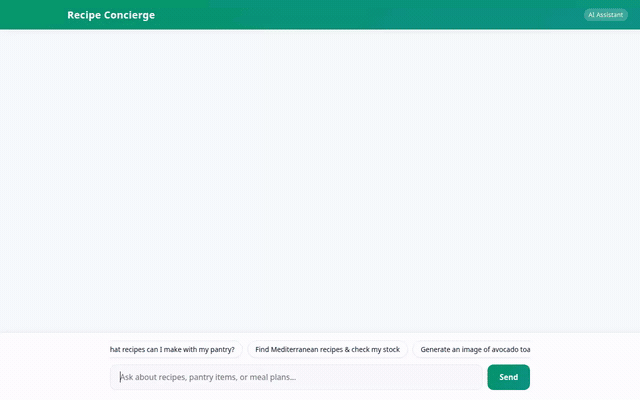

# Recipe Concierge 👨‍🍳

An intelligent, conversational AI recipe & pantry concierge built with Google's **Agent Development Kit (ADK)**, **Gemini 3.8 Flash**, **Vertex AI Memory Bank**, **Cloud Firestore**, and **A2UI**.



---

## 🌟 Overview

**Recipe Concierge** helps home cooks plan meals, search recipes, manage pantry inventory, find nearby grocery stores, and generate visual food photography. Powered by persistent long-term memory, the agent remembers user dietary restrictions, allergies, and preferences across sessions to ensure personalized and safe recommendations.

---

## 🚀 Implemented Features & Integrations

Based on the agent codebase in `app/`, the following Google Cloud services, tools, and UI features are fully implemented:

### 🧠 1. Cross-Session Long-Term Memory
- **Vertex AI Memory Bank**: Integrates `PreloadMemoryTool` and `generate_memories_callback` to persist user food allergies (e.g. peanuts, dairy, gluten), dietary preferences, and favorite ingredients across multiple sessions.

### 📦 2. Firestore Pantry & Recipe Database
- `list_recipes`: Fetches curated recipe collections from Cloud Firestore.
- `list_pantry_items`: Queries available pantry stock.
- `search_recipes`: Searches recipes by category or ingredient.
- `add_pantry_item`: Adds newly purchased items to the user's Firestore pantry.
- `add_recipe`: Stores new custom recipes in Firestore.
- `check_pantry_recipe_match`: Cross-references recipe ingredients against current pantry stock to highlight missing items.

### 📸 3. AI Dish Photography & Cloud Storage
- `generate_recipe_image`: Generates high-quality food dish photography using **Imagen 3** (`imagen-3.0-generate-002`) and stores output images in a public **Google Cloud Storage** bucket for inline UI rendering.

### 📍 4. Google Maps & Grocery Locator
- `geocode_address`: Converts addresses or city names into geographic coordinates using Google Maps Geocoding.
- `find_nearby_places`: Locates nearby grocery stores, supermarkets, and specialty food markets using Google Maps Places API.

### 💻 5. Code Execution Sandbox
- `AgentEngineSandboxCodeExecutor`: Executes Python code safely in Vertex AI Agent Engine Sandbox for scaling ingredient quantities and nutritional calculations.

### 🎨 6. A2UI Cards & Custom Chat UI
- **A2UI Integration**: Built with `A2uiSchemaManager` (version 0.8) and `BasicCatalog` to emit structured UI components (Cards, Columns, Rows, Images, and Material Icons).
- **FastAPI Proxy & Web Frontend**: Custom FastAPI proxy communicating over the **A2A protocol** with a modern, responsive chat interface.

---

## 📋 Planned / Future Enhancements

The following features from the initial roadmap are planned for future iterations:
- **Automatic Shopping List Export**: Exporting missing recipe ingredients directly to Google Keep or SMS (Planned).

---

## 🛠️ Local Setup & Instructions

### Prerequisites
- Python 3.11+
- `uv` package manager (`pip install uv`)
- Google Cloud CLI (`gcloud`) authenticated to your GCP Project
- Active Google Maps API Key (`GOOGLE_MAPS_API_KEY`)

### 1. Installation

Clone the repository and navigate into the project folder:

```bash
cd my-simple-agent
```

Set up environment variables in a `.env` file:

```bash
GOOGLE_MAPS_API_KEY=your_google_maps_api_key
```

### 2. Running Local ADK Playground

To test the agent locally using the ADK Web interface:

```bash
uv run adk web . --port 8080 --reload_agents
```

### 3. Running Custom Frontend Proxy

To run the custom FastAPI frontend proxy and web interface locally:

```bash
cd frontend
uv run python main.py
```

Then open your browser to the local server port printed in your terminal console.

---

## 📄 License

Apache License 2.0
